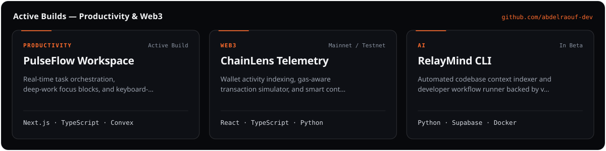
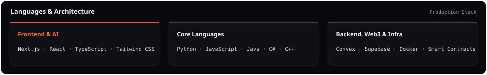

<!-- GitHub Profile Portfolio for Abdelraouf Abdelgader -->
<!-- IMPORTANT: Replace "abdelraouf-dev" with your exact GitHub username before committing if needed -->

  
    

  

    
  

   
  

    
  
   

  
<a href="https://github.com/abdelraouf-dev/pulseflow-workspace"><strong>PulseFlow Workspace</strong></a> (Productivity) &nbsp;·&nbsp; <a href="https://github.com/abdelraouf-dev/chainlens-telemetry"><strong>ChainLens Telemetry</strong></a> (Web3) &nbsp;·&nbsp; <a href="https://github.com/abdelraouf-dev/relaymind-cli"><strong>RelayMind CLI</strong></a> (AI)

   
  
    
  

    
    
    
    
    
    
    
    
    
    
    
  

   
  

    
    
  

  

    
  

   
  

  
<strong>Code. Build. Evolve.</strong> &nbsp;·&nbsp; Built in Montreal, Canada

